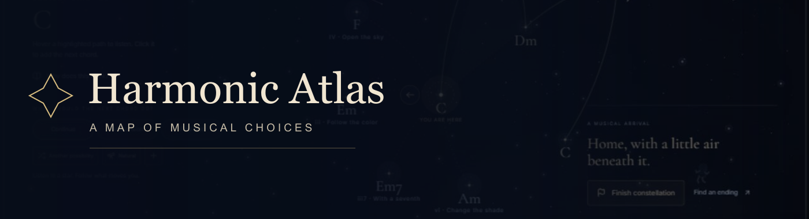
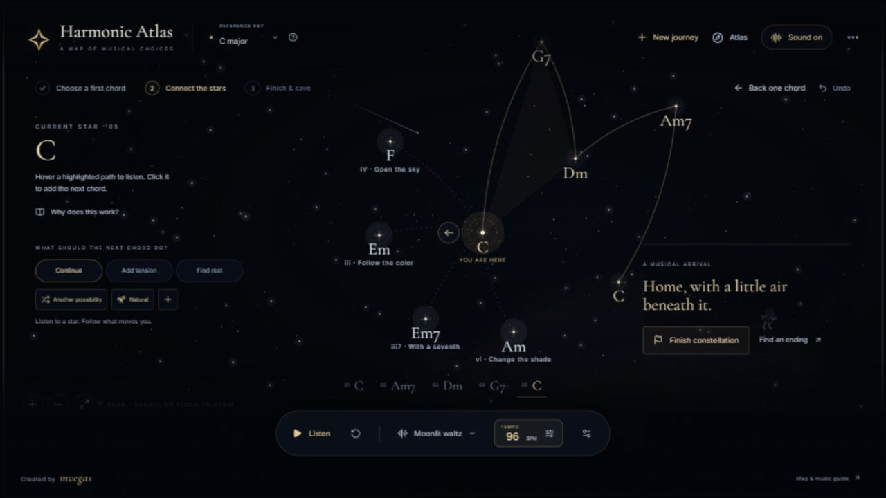
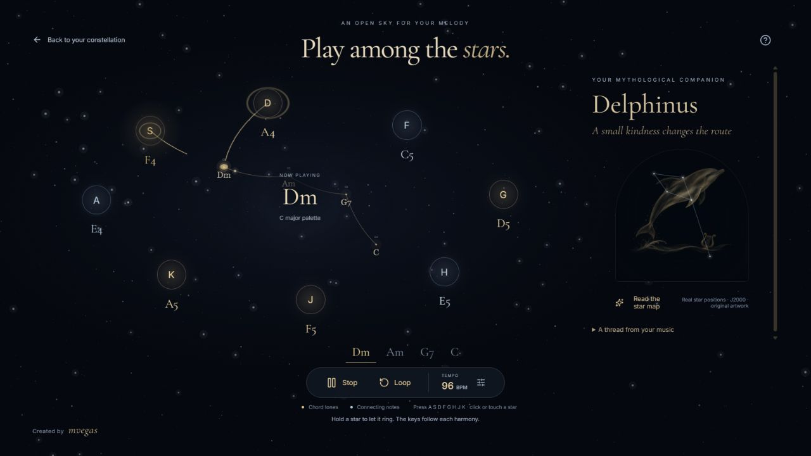

# Harmonic Atlas

**Make music by following a path through the stars.**

Harmonic Atlas is a personal project about composing, listening and finding ideas along the way. Pick a chord and build a constellation one harmony at a time. The paths offer suggestions when you want them; the full chord palette is there when you want to choose for yourself. You can move between both approaches at any point.

**[Open Harmonic Atlas](https://mvegas-lizard.github.io/harmonic-atlas-web/)** · [Listen to a piano example](landing/arpeggio-example.mp3) · [Share feedback](https://github.com/mvegas-lizard/harmonic-atlas-web/issues)

## Find your own way through

New to music theory? Start with a chord, listen to the highlighted stars and follow the sound you like. Ask the map to continue, add tension or find a place to rest. Short explanations help you hear why the chords connect, without needing to study first.

Already have something in mind? Choose from the chord palette, explore different chord colors and use the score and theory tools for more control. Suggestions are an invitation, and you can mix them with your own choices.

## Give the music a shape

Choose a tempo and accompaniment, from gentle chords to rising arpeggios. Each choice adds a star to your drawing. When the piece feels finished, listen back, explore its harmony and discover an illustrated mythological companion connected to your music. Your compositions and discoveries live in your Atlas.

You can also improvise a melody over your progression using a keyboard, mouse or touch. Export the finished piece as MP3, MIDI, a constellation drawing or a project file. The melody playground is for live playing and does not record melody takes.

The [short piano example](landing/arpeggio-example.mp3) is C–Am–F–G–C, arranged as a rising arpeggio using the app's Salamander Grand Piano samples by Alexander Holm ([CC BY 3.0](https://creativecommons.org/licenses/by/3.0/)). The samples have been repitched and mixed for this example.

## Come and explore

The app runs in your browser and is available in English and Spanish. Your Atlas is stored in that browser, so export a project file if you want a backup or want to move it to another device.

This is a personal project, open for anyone to try. If something surprises you, feels confusing or gives you an idea, [open an issue](https://github.com/mvegas-lizard/harmonic-atlas-web/issues). I'd love to hear about your experience.

---

Created by **mvegas**. Application code is [MIT licensed](LICENSE); piano recordings, fonts, libraries and star data have their own licenses. See [third-party notices](THIRD_PARTY_NOTICES.md) and the [illustration manifest](art/myths/manifest.json).
